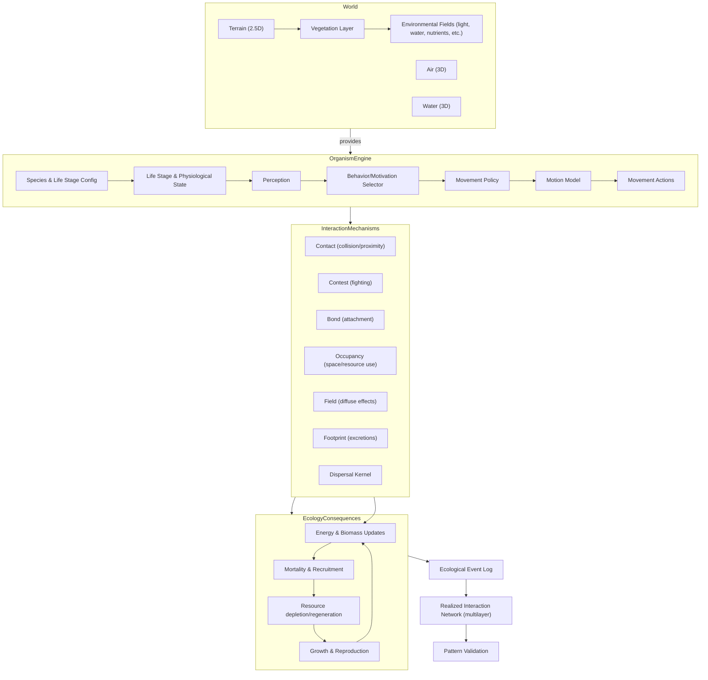

# Ecosystem ABM Design Document

## Executive Summary

This document specifies a **spatially explicit, multilayer agent-based model (ABM)** of a complex ecosystem. The simulation will include flying (birds, insects), terrestrial (mammals, insects), aquatic (fish, aquatic insects, waterbirds), and sessile (plants, trees, algae) species, each with one or more life stages and realm transitions (e.g. aquatic larva → aerial adult).  It will represent **multiple ecological interaction types** (trophic and non-trophic) as separate layers in a *potential interaction network*, while the ABM dynamics generate the *realized interaction events* among individuals.  Collective movement behaviors (flocking, schooling, swarming) will be implemented as **selectable movement policies** combined with appropriate physical motion models (e.g. aerial flight, swimming, surface travel).  

We adopt a **Pattern-Oriented Modeling (POM)** approach to guide development: we begin with key ecological patterns and questions (e.g. diversity maintenance, pollination networks, predator–prey spatial structure) and select mechanisms that reproduce those patterns.  We use the **ODD (Overview–Design concepts–Details)** protocol for formal model specification.  The model architecture centers on:
- A **“World” environment** partitioned into terrain, air, water and vegetation domains with biophysical fields (light, nutrients, currents, etc.).
- An **Organism Engine** in which each individual’s *species*, *life stage*, *state variables* (energy, age, etc.), *perception*, and *behavior* are defined.
- Seven **generic interaction mechanisms** (Contact, Contest, Bond, Occupancy, Field, Footprint, Dispersal Kernel) that capture all specified interaction types.
- An **event logging system** that records each ecological interaction, yielding a time-stamped *realized multilayer network* of interactions.
- A **hybrid scheduler** to handle multiple time scales (fine movement vs. plant growth vs. seasonal cycles).

The output will be a **C# simulation kernel** (for performance) controlled via Grasshopper/Rhino as the UI (parameters, experiment control, and visualization).  The design emphasizes extensibility (adding new species, interactions, behaviors), computational efficiency (spatial hashing, cohorts, continuous fields), and rigorous validation (POM pattern tests and ODD documentation).

## Project Purpose and Ecological Questions (Pattern-Oriented Modeling, POM)

**Primary purpose:** To simulate the dynamics of a richly interacting ecosystem where diverse animal taxa (fliers, terrestrial, aquatic) and plants engage via trophic (predation, herbivory, parasitism) and non-trophic (allelopathy, facilitation, nesting, epibiosis, pollination, etc.) interactions. The goal is both ecological insight and a research-quality tool: we want to understand how multi-layer interaction networks and movement behavior produce emergent patterns of community structure.

**Key ecological questions** (patterns to reproduce):
- *Coexistence and diversity:* How do multiple interaction types (beyond just food webs) affect species coexistence and community stability?
- *Network structure:* How do realized networks (food webs, pollination webs, competition webs) emerge from species’ potential interactions across space and time?
- *Collective movement impact:* How do flocking/schooling of prey or flock avoidance by predators alter predation risk and spatial distribution (cf. Couzin et al. 2002)? Which movement policies (alignment, aggregation) produce observed group shapes and densities?
- *Life-stage and realm transitions:* How do amphibious/insect life-cycles that change realms (water ↔ land ↔ air) influence species’ interactions and population dynamics?
- *Phenology and resource coupling:* How do plant flowering/dormancy cycles coupled with pollinator life-cycles affect pollination patterns and gene flow (e.g. pollen transfer, seed set)?

**POM approach:** We will identify empirical patterns (from literature or field data) at multiple scales (individual behavior, group structures, population cycles, network topology) and iteratively adjust model components until simulated patterns align with real ones.  The model will be kept in the “Medawar zone” of complexity: complex enough to capture key processes, but no more complicated than necessary.

## Model Specification (ODD Protocol)

Following Grimm et al. (2006, 2010), we structure the model specification as **Overview, Design concepts, Details (ODD)**.

### Overview

- **Purpose:** To explore how individual-level behaviors and multi-type interactions give rise to community-level ecological patterns.  
- **Entities and state variables:** 
  - *Environment:* A spatial grid/space divided into realms (terrain, air, water) plus layers of vegetation and resource fields (e.g. nutrient, light, pheromone).  
  - *Species:* Configured by a species list. Each species has one or more *life stages* (e.g. larva, adult; juvenile, adult), with stage-specific traits.
  - *Agents:* Individuals of each species and life stage. State variables include *position*, *velocity*, *energy*, *age/lifespan*, *health*, *reproductive state*, and stage-specific attributes (e.g. pollen load, egg count, parasite load).
  - *Resources:* Plant biomass, nectar/pollen in flowers, fruit/seed banks, substrate areas. These may be represented as agents (trees) or spatial fields (algae density, nectar concentration).
  - *Interaction network:* A **potential interaction graph** where nodes = species and labeled edges = possible interactions (predation, pollination, etc.) with attributes (effect sign, conditions).
- **Scales:** 
  - *Spatial:* Continuous space with effectively 3D for air/water, 2.5D (e.g. heightmaps) for terrain, plus discrete occupancy of substrate. 
  - *Temporal:* Multi-rate (see Scheduler). Individual movement updated at sub-second resolution; behaviors (foraging, combat) at seconds; physiological processes at minutes/hours; life-cycle and reproduction at days–seasons.
- **Process overview and scheduling:** 
  - At each simulation cycle, different processes are triggered at their own rates. Continuous movement is handled by short timesteps when needed. Periodic behaviors (foraging, interactions) occur at coarser steps. Seasonal events (breeding, flowering) happen at annual/seasonal steps. Each tick may involve perception (detect neighbors/resources), decision-making (select behavior), motion (update position), and interactions (if in proximity).  

### Design Concepts

- **Emergence:** Population and community-level patterns (distribution, diversity, network structure) emerge from local interactions and behaviors. Collective movement patterns (flocks, herds) emerge from simple alignment/attraction rules combined with individual goals.
- **Adaptation:** Agents have dynamic states (hunger, reproductive drive) influencing behavior. Movement behaviors can switch (e.g. foraging → pursuit → escape).
- **Objectives:** Individuals aim to survive and reproduce (implicitly maximize energy or fitness). We do not program global objectives; rather, goals like “find food” or “avoid predator” emerge from state variables.
- **Learning and Memory:** Certain species (e.g. pollinators, foraging birds) may have simple memory (e.g. learned locations of high-resource patches) or internal navigation (as in EcoSimInGrid).
- **Prediction:** We do not prespecify aggregate outcomes; predictive capabilities come from emergent behavior. However, we may measure and validate against expected patterns (flock polarization, population cycles).
- **Sensing:** Agents perceive local environment within a species-specific sensory radius or cone. This includes conspecifics, prey, predators, plants, resources. Sensory fields (e.g. scent) may mediate long-range attraction.
- **Stochasticity:** Many processes (mutation, survival, interaction success) include randomness. Movement policies may include random exploration components. Stochastic behavior is replicated and averaged for POM validation.
- **Collectives:** Agents may form dynamic groups. Group properties (size, shape) emerge without centralized control.
- **Observation:** The model logs events and state snapshots for analysis. Key emergent metrics include realized networks, spatial distributions, and population trends.

### Details

- **Initialization:** 
  - **Species configuration:** A table of species with traits (realm, life stages, senses, movement parameters, diet, etc.). For exploratory runs, we may leave many values open or randomly generated within constraints. The initial population of each species (or cohort) is placed randomly or via prescribed densities.
  - **Environment:** Terrain and vegetation layers are set up (e.g. random forest stands), initial resource fields (nutrients, water) are seeded. Initial plant individuals (trees, algae patches) are distributed. Environmental gradients (sunlight, climate) may be static or seasonal.
- **Input data:** User can define species/interactions via tables, and can load initial maps (terrain, vegetation). No external time series or GIS data is required but could be added.
- **Submodels:** 
  - **Organism Life-cycle:** Handles maturation, reproduction (gamete production, gestation, egg laying), mortality (natural death by age or energy exhaustion).
  - **Movement:** *MovementPolicy* selects desired motion (goals based on state, environment, neighbors), then *MotionModel* applies physics (speed, turning limits). For example, Couzin-like rules operate at the policy stage; physical velocity updates use a chosen integrator (e.g. semi-implicit Euler).
  - **Feeding/Foraging:** When encountering prey or plants, interactions occur according to “Contact” or “Field” rules (see Mechanisms).
  - **Reproduction & Parenting:** Mate seeking, nest-building (Occupancy mechanism), egg deposition.
  - **Growth & Vegetation:** Plants grow or senesce, produce biomass and seeds, compete for light/nutrients.
  - **Resource Regeneration:** Nectar and pollen fields regenerate on plant phenology schedules; deplete when consumed.
  - **Parasite dynamics:** Agents may carry parasite loads (Bond mechanism) and suffer health effects.
  
At each time step, the scheduler triggers agents to update based on their next deadline (movement, metabolism, reproduction, etc.), according to their assigned clock (see Scheduler). 

## System Architecture

The ABM consists of interconnected modules:



### World (Spatial Environment)

The **World** is partitioned into overlapping domains: 

- **Terrain (2.5D):** Land surface with elevation. Terrestrial animals move on terrain surface; obstacles (hills, water bodies) shape movement.  
- **Air (3D):** Open air volume for flying. Birds and flying insects have full 3D freedom.  
- **Water (3D):** Aquatic volume for swimming species. Stratification (depth layers) may affect light/oxygen.  
- **Vegetation Layer:** Plants, trees, algal patches anchored in soil or water. Represented as discrete agents or continuous fields (e.g. grasses).  
- **Substrates:** Special surfaces (soil, rock, canopy, water surface) on which organisms can occupy/nest.  
- **Environmental fields:** Grids or continuous fields for abiotic factors (temperature, moisture), resource fields (nutrient concentration, nectar density, pollen availability), and chemical fields (allelopathic toxins, pheromone trails, predator scent).  

*Realm constraints:* Each species/life stage has an allowed realm set. For example, a dragonfly nymph has *R=water* and uses a SwimmingMotion; the adult has *R=air+vegetationSurface* and uses a FlightMotion. Animals can transition realms only at permissible life stages (e.g. turtles surface to bask). Plants are fixed to terrain or submerged positions.

Resource dynamics (light gradients, nutrient diffusion, plant growth) are computed on a coarse time scale (minutes–hours). Dynamic effects (wind, currents) can influence movement policies but do not require fine-grained simulation (see Scheduler).

### Organism Engine

This module handles **individual agents**. Each agent instance has:

- **Species and Life Stage:** Defined by the species config. E.g. “Salmon – juvenile”, “Salmon – adult”.  
- **State variables:** Position (x,y,z), velocity, current energy reserves, age, health, hunger level, reproductive hormones, and any special state (pollen load, stomach fullness, attached parasite).  
- **Perception:** Each agent detects nearby objects within its sensory range (zone or cone). Perception can include other agents (predators, conspecifics, prey), plants (flowers, fruits), spatial cues (resource density), and pheromones.  
- **Internal State & Motivation:** Based on energy and needs, an agent’s state may be “foraging”, “escaping”, “mating”, “nesting”, etc. This is determined by a behavior selector (finite-state machine or utility-based decision).  
- **Behavior/Movement Policy:** Given its motivation, an agent chooses a movement policy, e.g. 
  - **Flocking/Schooling** (Couzin-style alignment/attraction)  
  - **Exploration/RandomWalk** (when searching)  
  - **ResourceSeeking** (move along gradient of resources or to a remembered site)  
  - **PredatorPursuit** (steer towards detected prey)  
  - **PredatorAvoidance/Evasion** (steer away, increase speed)  
  - **TerritorialPatrol** (follow home range patterns)  
  - **NestReturn/Migration** (directed travel to home site)  
- **Motion Model:** Once a desired velocity or heading is chosen, the motion model applies physics and constraints:
  - **Inertial 3D motion** with limits on acceleration and turn rate (for fishes, birds)  
  - **Terrain-constrained motion** that keeps footed animals on ground (2.5D)  
  - **Swimming model** with buoyancy and drag (for fish, aquatic insects)  
  - **Flight model** including lift/drag (for powered fliers)  
  - **Sessile** (no motion) for plants or anchored life stages.  

Movement policies produce a steering vector **S**, which is combined with other factors (avoid collisions, attraction to goals) and fed into the motion integrator (e.g. semi-implicit Euler). By separating *policy* (goal direction) from *motion model* (actual movement), we can mix-and-match behaviors: e.g. a bird and a fish might both use an “avoid predator” policy, but one flies and one swims.

### MovementPolicy vs. MotionModel Diagram

```mermaid
flowchart LR
    Perception --> InternalState
    InternalState --> BehaviorSelect
    BehaviorSelect --> MovementPolicy
    MovementPolicy -- steering vector --> MotionModel
    MotionModel -- new position --> [Agent moves]

    subgraph MovementPolicy
      CouzinFlocking["Couzin Flocking"]
      ResourceSeeking["Resource Seeking"]
      PredatorPursuit["Predator Pursuit"]
      PredatorAvoidance["Predator Avoidance"]
      RandomWalk["Random Walk"]
      Migration["Migration"]
      NestReturn["Nest Return"]
      Territorial["Territorial"]
    end

    subgraph MotionModel
      Inertial3D["Inertial 3D"]
      Flight["Flight (lift/drag)"]
      Swim["Swimming"]
      TerrainMove["Terrain-constrained"]
      SurfaceCrawl["Surface-crawling"]
      Sessile["Sessile (immobile)"]
    end

    CouzinFlocking --> Inertial3D
    ResourceSeeking --> Inertial3D
    PredatorPursuit --> Inertial3D
    PredatorAvoidance --> Inertial3D
    RandomWalk --> Inertial3D
    Migration --> Inertial3D
    NestReturn --> Inertial3D
    Territorial --> Inertial3D

    Flight -- used by --> CouzinFlocking
    Flight -- used by --> ResourceSeeking
    Flight -- used by --> PredatorAvoidance
    Swim -- used by --> CouzinFlocking
    Swim -- used by --> PredatorAvoidance
    TerrainMove -- used by --> Territorial
    Sessile -- used by --> (No movement)
```

### Interaction Mechanisms

We implement **seven generic mechanisms** (extracted from the evaluation report) that underlie all interactions:

- **Contact:** Direct encounter where two agents occupy the same space (collision, host–parasite contact, blood feeding). Example: a mosquito biting a mammal.  
- **Contest:** Aggressive interaction when two agents explicitly fight or compete (territorial fights, predator–predator interference).  
- **Bond:** Attachment relationship (a parasite on host, a bird with a tick, a climbing vine on a tree). Modeled by linking two agents until detachment.  
- **Occupancy:** Exclusive use of a resource or space (nesting in a burrow, occupying a territory, a flower being visited). Often exclusive or limited occupancy (one nest per burrow).  
- **Field:** Diffuse effect with a decay over space (allelopathic chemicals, scent marking, pheromone trails). Represented as fields that agents can emit or sense.  
- **Footprint:** Deposition of something at a location (seed drop, feces, urine, pheromone pheromone deposition), leaving a local resource or mark.  
- **Dispersal Kernel:** Movement of propagules (seeds, spores) via wind/water; can be seen as a stochastic relocation process to new sites.

These mechanisms are **composable**. A given ecological interaction type may use multiple mechanisms. For example, **pollination** involves a contact (flower visitation) that creates a bond of pollen cargo on the insect, plus a footprint (pollen deposited at a subsequent flower). **Predation** uses contact (attack) and results in energy transfer. **Plant allelopathy** is modeled via a field (toxic chemical diffusion). 

**Mapping interactions to mechanisms (examples):**

| Interaction       | Mechanisms                            |
|-------------------|---------------------------------------|
| Predation         | Contact (attack) + energy transfer    |
| Herbivory         | Contact + Footprint (plant damage)    |
| Pollination       | Contact (visit) + Bond (pollen cargo) + Footprint (pollen deposition) |
| Nectar feeding    | Contact + resource field depletion    |
| Parasitism        | Bond + contact (e.g. parasite attaches by bite) |
| Nesting           | Occupancy (territory/site)            |
| Oviposition       | Occupancy (site use) + Footprint (eggs) |
| Symbiosis (mutualistic) | Bond (temporary or persistent)    |
| Competition (space) | Field (allelopathy) or Contest       |
| Dispersal (wind)  | Dispersal Kernel + field (wind)       |
| Epibiosis (e.g. barnacles) | Bond                      |
| Hematophagy       | Contact (feeding) + Footprint (disease transfer) |
| Allelopathy       | Field (toxin diffusion)               |

Interaction rules are defined by **species’ capabilities**: a species may be configured to allow certain types of interactions with others (the “potential network”), but each actual interaction only occurs when agents meet the conditions (proximity, sufficient energy, behavioral state).  For example, `Bird → Insect : predation (+,-)` means birds *can* eat insects, but a given bird will do so only if an insect is detected, the bird is hungry, and an attack succeeds (modeled stochastically).  

### Event Schema and Realized Networks

Every interaction generates a standardized **EcologicalEvent** that is logged. An event record contains:
```
EcologicalEvent {
  time: timestamp,
  location: (x,y,z),
  sourceAgentID, targetAgentID,
  sourceSpecies, targetSpecies,
  interactionType: (e.g. "predation", "pollination", etc.),
  mechanism: (which generic mechanism(s) used),
  outcome: (success/failure or details),
  biomassTransfer, energyTransfer,
  sourceEffect, targetEffect (energy gained/lost, health change),
  duration, distance,
}
```
This event log is written to disk (for analysis/visualization) and used to construct *realized multilayer networks*. For any time window, we can aggregate events by type into networks (e.g. the pollination network linking pollinator species to plant species, a predation food web, a parasitism network).  Comparing these *realized* networks to the *potential interaction network* provides insight into realized ecological structure.

## Movement Models vs. Movement Policies

We provide multiple mobility implementations (motion models) and behavior options (policies). Below is a **comparison table**:

| Movement Model          | Description                                                         | Applicable Agents                 |
|-------------------------|---------------------------------------------------------------------|-----------------------------------|
| **Inertial3D**          | Point-mass with velocity; limited acceleration/turn rate.           | Most mobile animals (fish, birds) |
| **FlightModel**         | 3D motion with lift/drag (winged flight), limited stall angle.      | Birds, flying insects             |
| **SwimmingModel**       | Movement in water with drag, buoyancy, 3D or 2D constraints.         | Fish, aquatic insects             |
| **TerrainConstrained**  | 2D surface locomotion (z determined by terrain), friction, slope.   | Land mammals, crawling insects    |
| **SurfaceCrawler**      | Motion on canopy or substrate; includes climbing constraints.        | Arboreal animals, insects on plants |
| **Sessile**             | No locomotion; position fixed.                                      | Plants, stationary stages (egg)   |

| Movement Policy         | Behavior Focus                                                     | Example Agents                    |
|-------------------------|---------------------------------------------------------------------|-----------------------------------|
| **RandomWalk**          | Unbiased exploration; returns to home via homing mechanism.         | Many foragers                     |
| **CorrelatedWalk**      | Random with inertia (smooth turns)                                   | Insects searching flowers         |
| **ResourceSeeking**     | Move up gradient of resource (chemicals, nectar, prey scent).       | Pollinators (to flowers), predators (to prey smell) |
| **Flocking/Schooling**  | Align & cohere with neighbors, avoid crowding.       | Birds, fish, social insects       |
| **TopologicalFlocking** | Align with fixed number of nearest neighbors (as per Hemelrijk et al.).| Bird flocks                       |
| **PredatorPursuit**     | Direct chase towards perceived prey direction.                      | Lions, hawks                      |
| **PredatorAvoidance**   | Increase distance from nearest predator (often with speed boost).   | Fish schooling, zebra herds       |
| **TerritorialPatrol**   | Follow boundary or move within home range.                          | Carnivores, primates              |
| **NestReturn**         | Navigate to home/den location (possibly using landmark cues).        | Bees returning to hive            |
| **MateSeeking**         | Seek out potential mates during breeding season (might use calls or displays). | Many animals                |

Movement policy weights (e.g. strength of alignment vs. cohesion) are species-specific. We validate these by checking if known collective patterns emerge (e.g. schooling vs. milling states).

## Interaction Mechanisms Comparison

| Mechanism    | Examples of Use                                           | Key Parameters           |
|--------------|-----------------------------------------------------------|--------------------------|
| **Contact**  | Predator bites prey, mosquito on host, nectar uptake by mouthparts. | Radius of contact, attack success probability |
| **Contest**  | Wolves fighting over kill, males sparring, territorial push. | Initiation threshold, damage inflicted |
| **Bond**     | Parasite attached to host, epiphyte on tree, clownfish in sea anemone. | Attachment time limit, detachment triggers |
| **Occupancy**| Occupying nest hole, flower under visitation, territory occupancy. | Site capacity (1), occupancy duration |
| **Field**    | Allelochemical diffusion, pheromone trails, shading effects.    | Field radius, decay rate, effect magnitude |
| **Footprint**| Dropping seed, depositing feces, pollinaria (pollen masses).   | Deposit amount, retention time |
| **Dispersal**| Wind spreading seeds, water carrying spores.                 | Dispersion kernel (e.g. Gaussian radius) |

These mechanisms are invoked by species-configured interaction rules. For example, an *allelopathy* rule uses a **Field** with negative effect (toxin) on neighbors. A *mutualism* rule might create a **Bond** of +/+ benefit.

## Scheduler and Time Scales

We implement a **hybrid event-driven scheduler**. Different processes operate at different time scales to save computation:

- **Fine-scale updates (ms–s):** 
  - Agent locomotion and neighbor checks (when agents are in motion or engaged in avoidance/pursuit). A subsecond timestep (e.g. 0.05s) is used during active movement.  
  - Collision handling and Contact interactions.  
- **Short-scale behavior (1–10s):** 
  - Perception and decision updates (e.g. re-evaluating flock membership, predator evasion choice).  
  - Interactions like feeding or mating, treated as instantaneous events or short actions.  
- **Medium-scale (minutes):** 
  - Energy expenditure and digestion updates.  
  - Resource field dynamics (nectar replenishment, detritus decay).  
- **Day-scale (hours–days):** 
  - Plant growth/mortality and resource competition.  
  - Individual aging, hunger/digestive cycles, parasite development.  
- **Seasonal/Annual:** 
  - Life-cycle transitions (metamorphosis, flowering, breeding).  
  - Recruitment (germination, birth pulses) and migration.  

```mermaid
gantt
    title Time Scales for Ecological Processes
    dateFormat  HH:mm:ss
    axisFormat    %H:%M:%S
    %% Gantt is not ideal but we use it here as a timeline metaphor
    %% Tasks named by process category
    section Simulator Tick
    Movement/Collision    :m1, 2026-10-04 07:13:48, 00:00:05
    Sensory/Decisions     :m2, after m1, 00:00:10
    Interaction Events    :m3, after m2, 00:00:02
    section Physiological
    Metabolism Update     :h1, after m3, 00:05:00
    Nutrient Cycles       :h2, after h1, 01:00:00
    section LifeCycle & Ecology
    Plant Growth         :d1, after h2, 1d
    Flowering/Reproduction :d2, after d1, 7d
    Recruitment/Mortality :d3, after d2, 30d
```



**Note:** The above is conceptual. In practice, the engine will schedule processes without a fixed global time step: agents can have individual “next update” times, and events (e.g. interaction opportunity, movement update) occur as needed.

| Time Scale    | Example Processes                                  | Approx. Step |
|---------------|----------------------------------------------------|-------------|
| 0.01–0.1 s    | Agent locomotion, collision avoidance, streaming  | 50 ms      |
| 0.5–5 s      | Perception update (friends/enemies), pursuit       | 1–5 s      |
| 10–60 s      | Activity state checks, short-term memory updates    | 30 s       |
| Minutes       | Energy/metabolism, nectar/pollen regeneration     | 5 min      |
| Hours/Daily  | Plant growth, digestion, predator energy gain       | 1 h        |
| Days         | Aging, long-range travel updates (e.g. noon/daylight), seasonal cues | 1 day    |
| Season/Year  | Reproduction events, migration cycles, nesting     | 30–365 days|

We intentionally **do not use a single compressed timestep** for all processes, as that would either waste computation (if too fine) or miss events (if too coarse). Instead, each process has its own clock (inspired by EcoSimInGrid and ecological IBMs) and triggers when due.

## Data Schemas

We define structured data for agents and interactions. Example schemas (in JSON-like syntax):

```js
// Species Configuration (from input tables)
Species {
  id: "Hawk",
  lifeStages: [
    {
      name: "Juvenile",
      realms: ["air", "terrain"],
      size: 0.5,
      maxSpeed: 15.0,
      sensors: { range: 20.0, fieldOfView: 180 },
      diet: { "Bird": "predation", "Rodent": "predation" },
      interactions: ["predation", "nesting", "aggression"]
    },
    {
      name: "Adult",
      realms: ["air", "terrain"],
      // ... similar fields ...
    }
  ],
  // ... other species-level attributes ...
}
```

```js
// Agent state (stored in memory)
Agent {
  id: 417,
  species: "Hawk",
  lifeStage: "Adult",
  position: {x: 123.4, y: 98.7, z: 50.0},
  velocity: {vx: 5.0, vy: 0.0, vz: -1.0},
  energy: 75.3,
  age: 28.6,
  hunger: 0.2,
  state: "foraging", // current behavior state
  target: null,      // current goal object ID
  sensors: { lastScan: 105.3, ... },
  // ...
}
```

```js
// Potential Interaction Descriptor (species-level rule)
InteractionRule {
  sourceSpecies: "Bee",
  targetSpecies: "Flower",
  type: "pollination",
  mechanisms: ["Contact", "Bond", "Footprint"],
  effects: { bee: +NectarEnergy, flower: +1Pollination },
  conditions: { flowerHasNectar: true },
  probability: 0.9
}
```

```js
// Event log entry (realized interaction)
EcologicalEvent {
  time: 10422.85,
  position: {x: 123.4, y: 98.7, z: 0.0},
  sourceAgent: 417,   // Hawk ID
  targetAgent: 833,   // Rabbit ID
  sourceSpecies: "Hawk",
  targetSpecies: "Rabbit",
  interactionType: "predation",
  mechanism: ["Contact"],
  success: true,
  energyTransferred: 15.6,
  damage: 1.0,
  sourceEnergyChange: +15.6,
  targetHealthChange: -100.0
}
```

These schemas ensure clarity in implementation and ease of logging. They will be serialized (e.g. JSON or binary) for output.

## Implementation Guidance

- **Technology Stack:** The core simulation will be implemented in C# (RhinoCommon/.NET) for efficiency and multithreading. Grasshopper (Rhino8) will serve as the front-end for parameter input, scenario setup, and real-time visualization. Rhino8’s integration allows custom Grasshopper components written in C# (RhinoCommon) and scripting in Python3. GUI sliders and data trees in Grasshopper will control species tables, runtime variables, and visualization toggles.
- **Spatial Indexing:** Use a **uniform spatial hash grid or RTree** for efficient neighbor searches. RhinoCommon provides an `RTree` class (for static objects like trees). For moving agents, a dynamically updated uniform grid or k-d tree can speed up collision/neighbor queries. 
- **Multithreading:** Movement updates and some interactions (e.g. independent foraging) can be parallelized (Grasshopper’s C# components support multi-threading). However, careful locking is needed for events that change shared state (e.g. consuming a nectar patch).
- **Prototyping:** High-level behaviors (e.g. flocking rules, resource search strategies) can be prototyped in Python components for ease, then ported to optimized C#. Python can also handle scenario generation or data analysis offline.
- **Data Output:** The engine will periodically emit lightweight snapshots (agent positions, current interactions) for visualization, plus append-only logs for the EcologicalEvent stream. Visualization components will draw agents (with species color), trails, and optional network overlays (e.g. drawing lines between interacting agents).
- **Grasshopper UI:** Provide panels for editing species traits, interaction rules (the potential graph), and environmental parameters (terrain shape, plant densities). Use data trees to define species lists and matrices. A “Start/Pause/Step” control will run the C# kernel loop. Visualization can include *“toy world”* geometry (globe or 2D map) and charts (population counts, network metrics).

## Scalability Strategies

To handle potentially thousands of agents and long simulations:

- **Multi-resolution representation:** Represent populations at appropriate resolution.
  - **Individual-based:** Key species and life stages (large vertebrates, keystone pollinators) are explicit agents.
  - **Super-individuals (cohorts):** Highly abundant but less critical taxa (many insects, zooplankton) can be grouped. A cohort agent represents N identical individuals sharing state (Railsback & Harvey, 2002).  
  - **Continuous fields:** Tiny organisms (algae, bacteria) or resource densities can be modeled as spatial fields rather than discrete. For example, a plankton bloom might be a 3D density field that interacts with fish (mass foraging).  
- **Adaptive resolution:** Switch representation dynamically (e.g. spawn individual prey agents when a predator approaches a high-density cohort).
- **Spatial partitioning:** Divide the world into sectors and update them separately when possible. Use **spatial hashing** (uniform grid) for O(n) neighbor queries; this avoids O(n²) checks.
- **Event-driven skipping:** Agents at rest (e.g. sleeping, dormant plants) need infrequent updates. The scheduler will skip them until an event (sunrise, predator arrival) wakes them.
- **Efficient physics:** The motion integrator and collision detection should be optimized (e.g. simple Euler for quick update, or using Rhino geometry collision only when needed).
- **Benchmarking:** Profile critical loops (neighbor search, movement update) and optimize (C# JIT is fast, but poor math code can be slow). Consider Unity ECS-style patterns if needed (entity-component arrays).
  
These strategies align with POM: we add detail only where it affects target patterns. For instance, if herbivory on a plant patch is needed, we may represent plant biomass as a local variable rather than tracking every leaf.

## Validation Plan (POM Patterns & ODD)

We will validate the model using the **POM framework**:

- **Define patterns:** We collect patterns that the model should reproduce. Examples:
  - Spatial statistics: average nearest-neighbor distances in flocks, group polarization angles, school shape metrics.
  - Population dynamics: predator-prey oscillations, pollinator-plant mutualistic network structure.
  - Network patterns: degree distributions of food webs, connectance of pollination networks, redundancy of interaction layers (as in Kéfi et al. 2012).
- **Run scenarios:** For each pattern, set up a scenario (e.g. only one predator and one prey species to test schooling effectiveness, or a plant-pollinator guild to test pollination).
- **Compare model vs. real:** Use statistical measures or visual fits. For collective motion, compare flock trajectories to Couzin benchmarks. For networks, compare synthetic network properties (nestedness, modularity) to empirical studies.
- **Calibrate with multi-pattern approach:** Instead of tuning to one metric, adjust parameters so that multiple independent patterns are simultaneously matched (the POM “multiple pattern constraint”).
- **Uncertainty & Sensitivity:** Perform sensitivity analysis on key parameters (movement weights, interaction probabilities) to identify which influence outcomes. Use replicates to account for stochasticity.

The ODD documentation ensures transparency: every assumption, process, and parameter is explicitly listed. We will provide the ODD sections as part of the deliverables. This allows peer review and reproducibility of the model design.

## Development Roadmap

1. **Formal Specification:** Write the ODD document and POM pattern list. Define species list and life stages (placeholders if needed). Create the initial potential interaction matrix (who *can* interact with whom, under what type).
2. **Core Simulation Kernel:** Implement base infrastructure in C#: world containers, agent classes, scheduler, spatial index, and event logging. Test with simple agents (random walkers) to verify mechanics.
3. **Movement Module:** Implement motion models and policies. Validate flocking and schooling (e.g. reproduce Couzin swarming patterns by tuning alignment zone). Test predator–prey pursuit-evasion in 2D/3D (inspired by Lin & Abaid, 2013).
4. **Interaction Engines:** Code the seven mechanism modules. Start with **Contact** (collision detection, predator–prey feeding) and **Footprint** (resource consumption). Then add **Field** (e.g. pheromones/allelopathy) and **Occupancy**. Validate each with simple tests (e.g. two agents in contact trigger predation).
5. **Organism Behaviors:** Add state machines for basic behaviors: foraging, fleeing, nesting. Integrate movement policies triggered by perception (e.g. see predator → switch to avoidance). Test multi-agent scenarios (a predator approaching a flock).
6. **Life-cycle & Demography:** Implement aging, reproduction, and stage transitions. Include plant growth and reproduction (seed production, dispersal). Test population processes (e.g. logistic growth of a plant with pollination).
7. **Full Ecosystem Integration:** Combine all modules. Populate with a minimal community (e.g. 3 plants, 3 pollinators, 2 predators) and run. Debug state consistency, event logs. Check energy balance (no sources/sinks beyond defined).
8. **Visualization & UI:** Build Grasshopper interface elements. Visualize agents (points or symbols), draw interaction edges on demand, color-code species/layers. Implement control to run/stop and adjust speed.
9. **Calibration & POM Testing:** Define target patterns (e.g. specific network structures or movement statistics). Use the event log and summary outputs to measure pattern metrics. Adjust parameters iteratively, or consider automated calibration (e.g. genetic algorithms guided by POM pattern fits).
10. **Scaling & Optimization:** Profile performance with increasing agent counts. Introduce super-individuals or fields for large populations. Optimize hot loops or consider GPU acceleration if needed.
11. **Documentation:** Finalize ODD, user manual, and developer notes. Publish code repository (with examples) and a webograph of key papers.

At each step, **unit tests** and **pattern checks** ensure correctness. For example, after coding flocking, we verify that the Boids (separation/alignment/cohesion) produce cohesive flocks. After interaction coding, we check that a predator indeed reduces prey energy and adds to its own. Maintaining the POM vision prevents feature creep: only implement a mechanism if it improves pattern fidelity.

## References

- Couzin, I. D., Krause, J., James, R., Ruxton, G. D., & Franks, N. R. (2002). *Collective memory and spatial sorting in animal groups*. *Journal of Theoretical Biology*, **218**, 1–11. (Demonstrates 3D grouping with local zones of repulsion/alignment/attraction).
- DeAngelis, D. L., & Grimm, V. (2014). *Individual-based models in ecology after four decades*. *Annual Review of Ecology, Evolution, and Systematics*, **45**, 1–21. (Review of ecological IBM methodology).
- Grimm, V., Revilla, E., Berger, U., *et al.* (2005). *Pattern-oriented modeling of agent-based complex systems: lessons from ecology*. *Science*, **310**(5746), 987–991. (Outlines POM approach).
- Grimm, V., *et al.* (2006). *A standard protocol for describing individual-based and agent-based models (ODD)*. *Ecological Modelling*, **198**, 115–126. (ODD protocol).
- Hemelrijk, C. K., & Hildenbrandt, H. (2011). *Some causes of the variable shape of flocks of birds*. *PLoS ONE*, **6**(8): e22479. (Topological interaction rules and 3D flock shape).
- Kéfi, S., Miele, V., Wieters, E. A., *et al.* (2012). *More than a meal… integrating non-feeding interactions into food webs*. *Ecology Letters*, **15**(4), 291–300. (Definition and modeling of non-trophic interactions).
- Pilosof, S., Porter, M. A., Pascual, M., & Kéfi, S. (2017). *The multilayer nature of ecological networks*. *Nature Ecology & Evolution*, **1**, 0101. (Framework for multilayer ecological networks).
- Qu, H., Jänicke, A., Gippner, P., et al. (2013). *A spatially explicit agent-based simulation platform (EcoSimInGrid) for shared pollination services*. *Ecological Modelling*, **259**, 181–189. (Pollination ABM platform).
- Reynolds, C. W. (1987). *Flocks, herds and schools: A distributed behavioral model*. *ACM SIGGRAPH Computer Graphics*, **21**(4), 25–34. (Classic Boids model: separation, alignment, cohesion).
- Railsback, S. F., & Grimm, V. (2011). *Agent-based and individual-based modeling: a practical introduction*. (Chapter on cohorts/super-individuals). Princeton University Press.
- (Supplied evaluation .md “Non-trophic interactions and herd movement” and “Evaluation of Boids ecosystem report”.)

**Bibliography/Webography:**

- ODD Protocol and ABM concepts – Open ABM Consortium: [UFZ ODD page](https://www.ufz.de/index.php?en=40429).
- Pattern-oriented modeling – Wikipedia: [Pattern-oriented modeling](https://en.wikipedia.org/wiki/Pattern-oriented_modeling).
- Reynolds Boids – Wikipedia: [Boids (Reynolds)](https://en.wikipedia.org/wiki/Boids).
- Pilosof et al. 2017 – [Nature Ecology & Evolution abstract](https://www.nature.com/articles/s41559-017-0101).
- Kéfi et al. 2012 – [Ecology Letters full text](https://onlinelibrary.wiley.com/doi/full/10.1111/j.1461-0248.2011.01732.x).
- Grimm et al. (2006) – [UFZ summary](https://www.ufz.de/index.php?en=40429).
- (Additional sources cited above.)